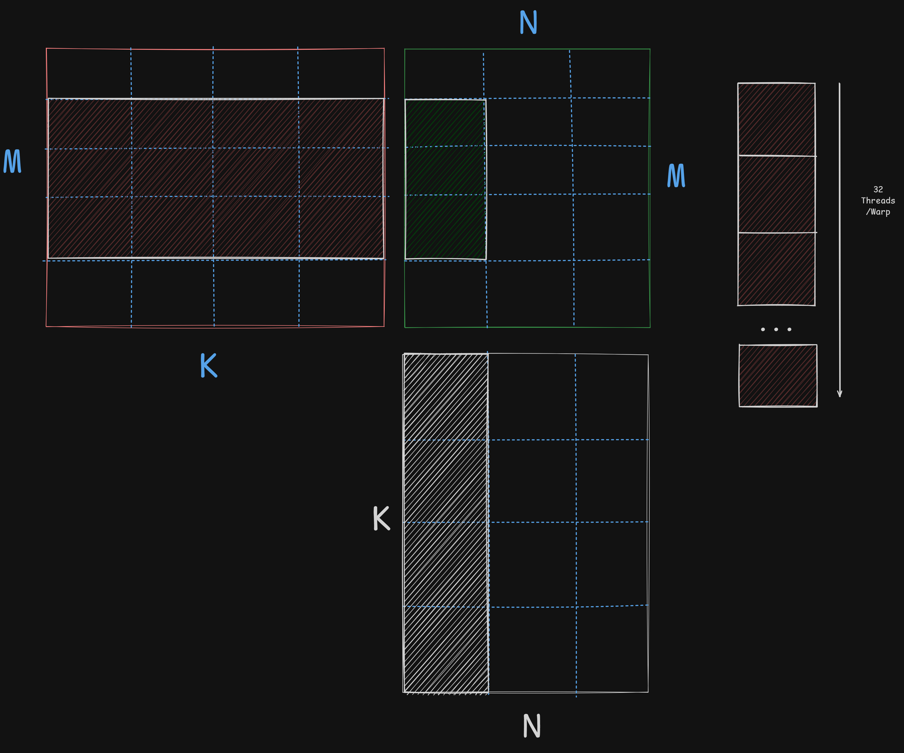
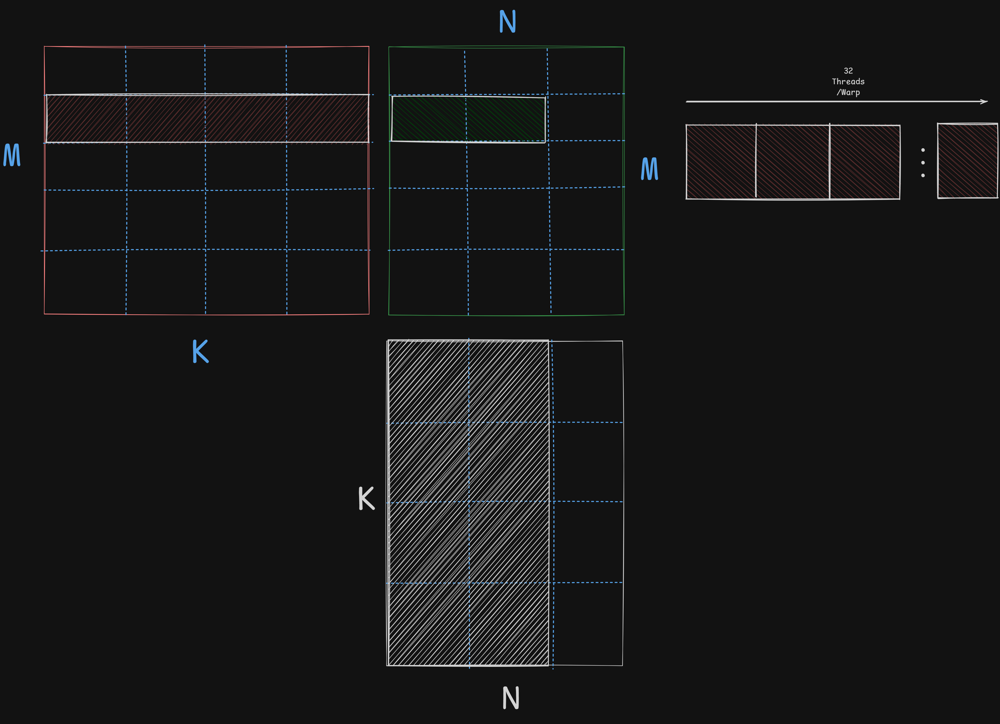
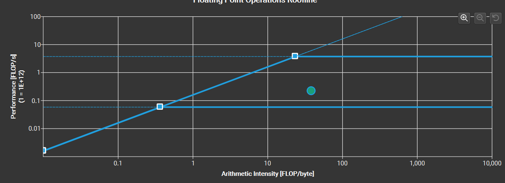

# Introduction

In Naive matmul implementation, the kernel exhibited poor memory sector utilization and significant LG Throttle stalls, indicating that memory access patterns were worth investigating. In this iteration, we modify the thread-to-output mapping to improve global memory access coalescing. The objective is to make better use of each memory transaction, reduce unnecessary memory instruction overhead, and evaluate how these changes affect overall kernel performance.

### Understanding the Memory Access Pattern

In the naive implementation, each CUDA thread computes one element of the output matrix \(C\). Threads are organized into warps of 32 threads, which are scheduled on Streaming Multiprocessors (SMs) for execution.

Consider a warp of 32 threads computing elements along the same row of \(C\). To calculate each output element, a thread iterates over the reduction dimension \(K\), accumulating products of corresponding elements from \(A\) and \(B\).

Let's examine the memory access pattern at a fixed iteration \(k\), where \(0 <= k < K\).

  

Img 1: Naive matrix multiplication thread mapping: each thread computes one output element, with adjacent warp lanes varying the row coordinate while keeping the column coordinate fixed.

#### Matrix A — Strided Access

For a given output row, each thread needs an element from \(A\) at:

$$
A[row][k] \Rightarrow A[row \cdot K + k]
$$

In the naive thread mapping, adjacent threads vary the row coordinate while keeping the column coordinate fixed. Consequently, their accesses are separated by \(K\) elements:

$$
A[row][k],\ A[row+1][k],\ A[row+2][k],\ \ldots
$$

This results in strided memory accesses, reducing the efficiency of memory transactions.

#### Matrix B — Broadcast Access

Each thread also accesses an element from \(B\) at:

$$
B[k][col] \Rightarrow B[k \cdot N + col]
$$

Since adjacent threads vary the row coordinate of the output while keeping the column coordinate fixed, they all access the same \(B\) element at this iteration:

$$
B[k][col],\ B[k][col],\ B[k][col],\ \ldots
$$

This access pattern allows the same value to be broadcast across the warp.

Therefore, although the \(B\) access benefits from broadcast, the strided access pattern in \(A\) results in inefficient global memory transactions.

### Coalesced Access

  

By changing the thread-to-output mapping, we can improve the memory access pattern. Instead of adjacent threads varying the output row, they now vary the output column while keeping the row fixed.

#### Matrix A — Broadcast Access

For a given output row, each thread accesses an element from \(A\) at:

$$
A[row][k] \Rightarrow A[row \cdot K + k]
$$

Since adjacent threads now share the same output row, they access the same element of \(A\) at a fixed iteration \(k\):

$$
A[row][k],\ A[row][k],\ A[row][k],\ \ldots
$$

This allows the value to be broadcast across the warp.

#### Matrix B — Coalesced Access

Each thread accesses an element from \(B\) at:

$$
B[k][col] \Rightarrow B[k \cdot N + col]
$$

As adjacent threads vary the output column, their accesses to \(B\) are contiguous:

$$
B[k][col],\ B[k][col+1],\ B[k][col+2],\ \ldots
$$

Since these addresses are adjacent in row-major memory layout, the memory requests can be coalesced into fewer memory transactions, improving global memory access efficiency.

### Profiling Results — After Memory Coalescing

After modifying the thread-to-output mapping to improve global memory access coalescing, we profile the kernel again using Nsight Compute to evaluate the impact of this change.

The results show a significant improvement across several performance metrics.

#### 1. Improved Compute Throughput and SM Utilization

The most noticeable change is the increase in Compute (SM) Throughput, from **22.69% to 92.79%**.

Similarly, SM Busy increased from **7.75% to 32.13%**, indicating that the Streaming Multiprocessors are now spending a greater proportion of time actively executing instructions.

This suggests that improving memory access efficiency has helped the SMs make better progress through the kernel rather than spending as much time stalled on memory instructions.

#### 2. Improved Memory Transaction Efficiency

The global memory access pattern also shows a considerable improvement in sector utilization.

Previously, approximately 4.2 bytes out of each 32-byte sector were utilized. After coalescing, this increased to approximately **18 bytes per 32-byte sector**.

Although this is a significant improvement, only around 56% of each sector is utilized on average. This indicates that there is still room to improve memory transaction efficiency.

#### 3. Reduction in LG Throttle Stalls

Another important observation is the reduction in LG Throttle stalls.

The average LG Throttle cycles per issued instruction decreased from approximately 118.3 to **21.89**.

This indicates that warps are encountering substantially less throttling when issuing local/global memory instructions. The reduction is consistent with the improved memory access pattern, although further experiments would be needed to establish the exact contribution of coalescing.

#### 4. Roofline Analysis

  

The Roofline plot shows a shift in the kernel's performance point.

The achieved performance has increased, moving the point upward on the plot. Its horizontal position has also shifted, indicating a change in measured arithmetic intensity.

This is expected because the profiler's measured memory traffic has changed with the improved access pattern. The mathematical operation and total FLOP count, however, remain unchanged.

#### 5. Kernel Execution Time

Most importantly, these improvements translate into a significant reduction in actual kernel execution time.

| Metric                                    |          Before |          After |
| ----------------------------------------- | --------------: | -------------: |
| Kernel duration                           |       694.50 µs |      155.20 µs |
| Compute (SM) Throughput                   |          22.69% |         92.79% |
| SM Busy                                   |           7.75% |         32.13% |
| Global load sector utilization            | ~4.2 / 32 bytes | ~18 / 32 bytes |
| LG Throttle cycles per issued instruction |          ~118.3 |          21.89 |

The kernel execution time decreased from **694.50 µs to 155.20 µs**, representing approximately a **4.48× speedup** or a 77.65% reduction in execution time.

### Conclusion

Changing the thread-to-output mapping to improve memory coalescing resulted in a substantial performance improvement. Better memory sector utilization, reduced LG Throttle stalls, and increased SM activity are consistent with the observed reduction in kernel execution time.

However, global memory sector utilization is still only approximately 56%. This leaves an opportunity to investigate further improvements in memory access efficiency.

In the next iteration, we will investigate how to exploit data reuse through shared memory and reduce redundant global memory accesses using **tiled matrix multiplication**.
