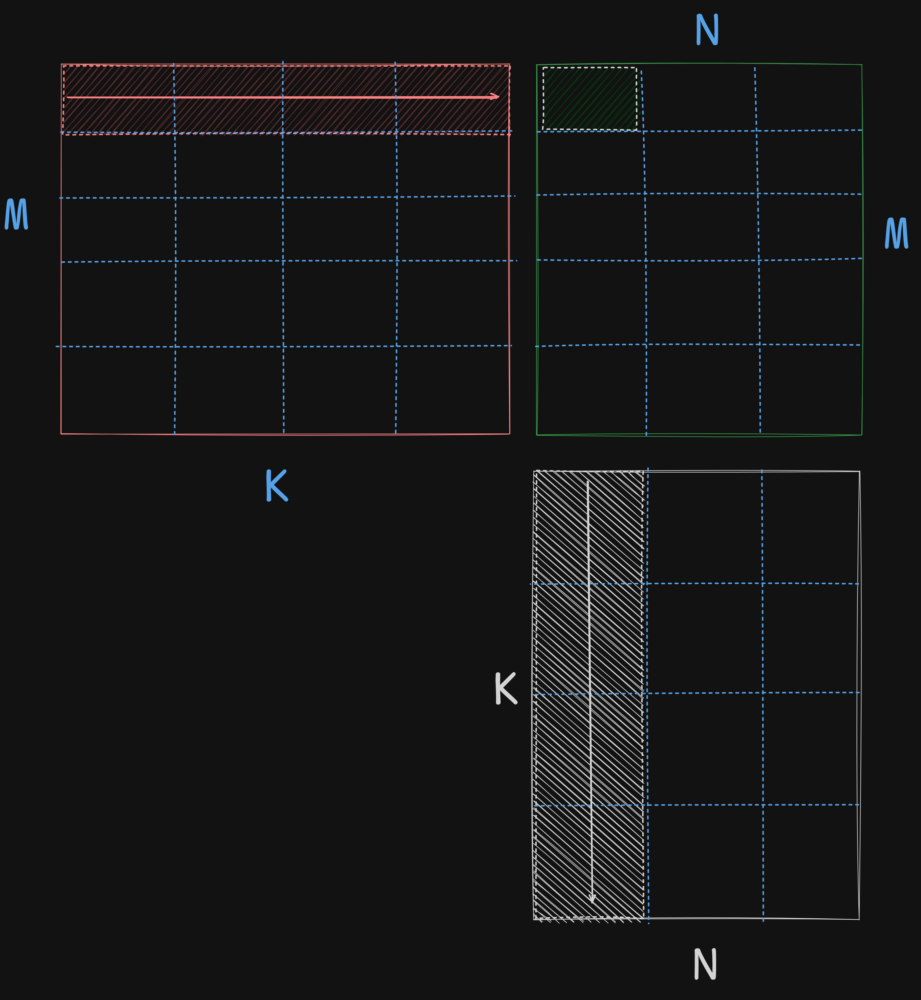
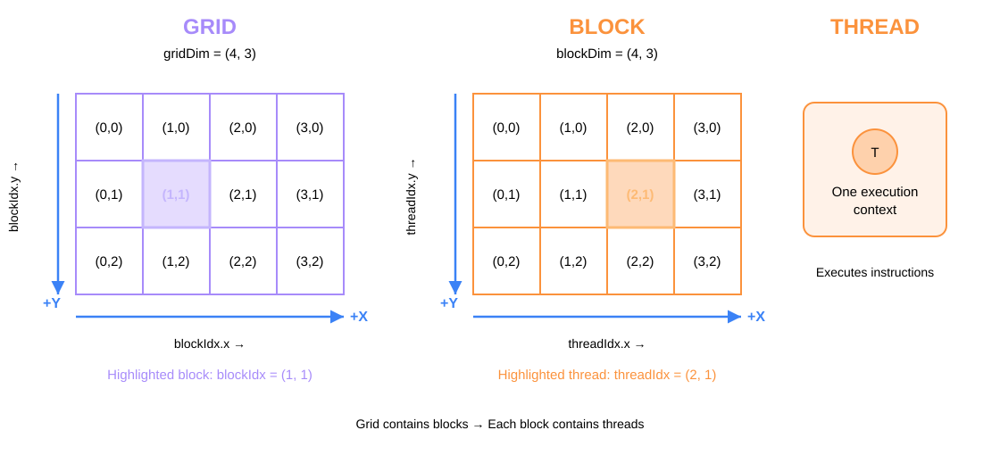
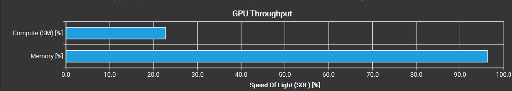
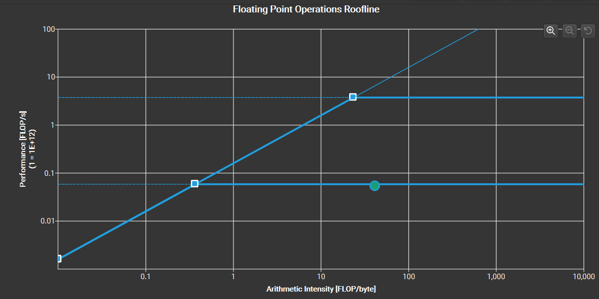

# Naive Matrix Multiplication — Establishing the Baseline

Matrix multiplication (matmul) is one of the most fundamental operations in computing, with applications ranging from neural networks to scientific computing. GPUs are widely used for matmul because of their ability to exploit massive parallelism and accelerate these workloads.
In this worklog, I will iteratively optimize GPU matrix multiplication by profiling performance, identifying bottlenecks, and improving the kernel to get as close to peak GPU performance as possible.

## 1. Understanding the Operation

Matrix multiplication takes two matrices, A and B, and produces a third matrix C.

$$
\underbrace{A}_{M \times K}
\times
\underbrace{B}_{K \times N}
=
\underbrace{C}_{M \times N}
$$

The dimensions describe the structure of the operation:

- A has M rows and K columns.
- B has K rows and N columns.
- C has M rows and N columns.

The inner dimensions (K) must match. This is the dimension along which multiplication and accumulation take place.

### Computing an Individual Output Element

Every element of the output matrix C is computed using the dot product of a row from A and a column from B.

<div align="center">
  
</div>
<div align="center">
Img 1: Matmul Operation where we take row of A and col of B to produce c at position 0,0
</div>

$$
c_{i,j} =
\sum_{k=0}^{K-1}
a_{i,k} \, b_{k,j}
$$

Expanding the summation:

$$
\begin{aligned}
c_{i,j} ={}&
a_{i,0}b_{0,j}
+ a_{i,1}b_{1,j} \\
&+ \cdots +
a_{i,K-1}b_{K-1,j}
\end{aligned}
$$

In other words, corresponding elements from the selected row and column are multiplied, and their products are accumulated into a single output value.

### Computational Structure

This operation is repeated for every row-column combination to construct the output matrix.

- Number of output elements: $M \times N$
- Operations per output element: $K$ multiply-accumulate steps.
- Total computational complexity: We need to perform K multiply-accumulate for every elements in C i.e MxN leaving us $O(MNK)$.

An important observation is that **each output element can be computed independent of each other**, exposing parallelism that can be exploited when implementing matrix multiplication on a GPU.

## 2. Niave Cuda Kernel

As discussed earlier, we will exploit the fact that each output element can be computed independently. We will map each output element to a separate GPU thread on our NVIDIA RTX 3050 Ti Laptop GPU.

Before proceeding, it's important to understand CUDA's three-level execution hierarchy: Grid → Blocks → Threads.

One distinction worth keeping in mind: this hierarchy is part of CUDA's programming model. The actual computation is executed by the GPU's Streaming Multiprocessors (SMs), which schedule and execute thread blocks on the hardware. The CUDA programming model provides an abstraction that allows us to organize and express this parallelism.

<div align="center">
  
</div>
<div align="center">
Img 2: 4x3 = 12 blocks each containing 4x3=12 threads. (2D representation but in practice grids and blocks can span till 3 dimensions)
</div>

### Global Thread Position

The important factor is that block indices and thread indices are local to their respective hierarchy levels.
For the highlighted block and thread:

$$
blockIdx = (1,1)
$$

$$
threadIdx=(2,1)
$$

Their combined global thread position is:

$$
x = blockIdx.x * blockDim.x + threadIdx.x
$$

$$
y = blockIdx.y * blockDim.y + threadIdx.y
$$

These coordinates identify the thread's position across the entire grid.

To obtain a single linear index from these 2D coordinates, we flatten them row by row:

$$
globalId = y \times (gridDim.x \times blockDim.x) + x
$$

> You can think of this flattening operation as skipping all the threads in the preceding rows, then moving to the \(x\)-th thread in the current row.

Consider the following configuration:

- `gridDim = (4, 3)` — 4 blocks along X and 3 along Y.
- `blockDim = (4, 3)` — 4 threads along X and 3 along Y.
- `blockIdx = (1, 1)`
- `threadIdx = (2, 1)`

First, calculate the global coordinates:

$$
x = 1 \times 4 + 2 = 6
$$

$$
y = 1 \times 3 + 1 = 4
$$

The total number of threads along the X dimension is:

$$
3 \times 4 = 12
$$

Therefore, the flattened global thread ID is:

$$
globalId = 4 \times 12 + 6 = \boxed{54}
$$

This is equivalent to flattening a 2D array: the Y coordinate determines the row, while the X coordinate determines the position within that row.

### Implementation

Now that we understand CUDA's execution model, we can implement our first naive matrix multiplication kernel.

The idea is straightforward: assign each CUDA thread the task of computing one element of the output matrix C.

Each thread identifies its corresponding row in A and column in B, then iterates over the shared dimension (K).At every iteration, it multiplies the corresponding elements from the selected row and column, accumulating their products into a single output value.

Once all (K) iterations are complete, the thread writes the accumulated result to its assigned position in C.

This approach directly maps the mathematical definition of matrix multiplication to CUDA's thread execution model.

```cpp
__global__ void matrix_multiplication_kernel(const float* A, const float* B, float* C, int M, int N, int K) {
    int row = blockIdx.x * blockDim.x + threadIdx.x;
    int col = blockIdx.y * blockDim.y + threadIdx.y;

    if (row < M && col < N){  // Guard from going out of bounds
        float sum = 0.0f;
        for (int i = 0; i < K; i++){
            sum += A[row * K + i] * B[i * N + col];
        }
        C[row * N + col] = sum;
    }
}
```

### Back-of-the-Envelope Roofline Analysis

Before profiling our naive kernel, let's derive a theoretical estimate of its arithmetic intensity. This will help us understand where the kernel might lie on the Roofline model.

A Roofline plot relates **achievable computational performance (FLOP/s)** to **arithmetic intensity (FLOP/Byte)**. It helps us understand the performance limits imposed by the hardware's peak compute throughput and memory bandwidth.

For simplicity, let's assume square matrices of size \(N \times N\), with single-precision (`float`) elements.

#### 1. Floating-Point Operations

Our output matrix \(C\) contains \(N^2\) elements.

To compute each element, we perform:

- \(N\) floating-point multiplications.
- \(N\) floating-point additions.

Counting one multiplication and one addition as two FLOPs, the total work per output element is:

$$
2N \text{ FLOPs}
$$

Since there are \(N^2\) output elements, the total floating-point operations are:

$$
\boxed{FLOPs = 2N^3}
$$

#### 2. Memory Traffic

For every output element, our naive kernel:

- Reads \(N\) elements from a row of A.
- Reads \(N\) elements from a column of B.
- Writes one resulting element to C.

Therefore, each output element requires \(2N\) element reads and one element write.

Across all \(N^2\) output elements:

**Total reads:**

$$
2N \times N^2 = 2N^3 \text{ elements}
$$

**Total writes:**

$$
N^2 \text{ elements}
$$

Hence, the total memory traffic, measured in elements, is:

$$
2N^3 + N^2
$$

Since each single-precision element occupies 4 bytes:

$$
\boxed{Bytes = (2N^3 + N^2) \times 4}
$$

#### 3. Arithmetic Intensity

Arithmetic intensity is the ratio of floating-point operations performed to the bytes transferred:

$$
AI = \frac{FLOPs}{Bytes}
$$

Substituting our estimates:

$$
AI = \frac{2N^3}{4(2N^3+N^2)}
$$

Simplifying:

$$
\boxed{AI = \frac{N}{4N+2}}
$$

As \(N\) becomes large:

$$
\lim_{N \to \infty} AI = \boxed{0.25 \text{ FLOP/Byte}}
$$

This gives us an initial estimate of the arithmetic intensity of our naive implementation.

### Profiling with Nsight Compute

> Refer profile.pdf for actual profiled data of the kernel.

After establishing our theoretical expectations, let's profile the naive kernel using **NVIDIA Nsight Compute** and understand how it actually behaves on the GPU.

#### 1. Memory Throughput vs Compute Throughput

The first thing that stands out is the difference between memory-side and compute-side utilization.



| Metric                  | Utilization |
| ----------------------- | ----------: |
| Compute (SM) Throughput |      22.69% |
| Memory Throughput       |      96.31% |
| L1/TEX Cache Throughput |      98.27% |
| L2 Cache Throughput     |       3.39% |
| DRAM Throughput         |       0.79% |

The memory-side pipelines are considerably more utilized than the compute pipelines.

This is not entirely surprising for our naive implementation. Each output element requires two memory loads (one from A and one from B) for every multiply-accumulate operation. We perform relatively little arithmetic for the number of load instructions issued.

However, notice that DRAM throughput is only 0.79%, despite the high memory and L1/TEX throughput. This suggests that we are not saturating external DRAM bandwidth. We need to look more closely at the memory access patterns and cache hierarchy to understand where the pressure originates.

#### 2. Comparing Theoretical and Measured Roofline Positions



We can observe a difference between the arithmetic intensity derived from our hand calculation and the position of the kernel on the measured Roofline plot.

This difference can be explained by the GPU's hierarchical memory access pattern.

Our theoretical calculation considers every logical load from A and B as a memory transfer. However, in practice, the GPU's memory hierarchy (L1 cache, L2 cache, and DRAM) allows frequently accessed data to be reused without repeatedly fetching it from DRAM.

As a result, the actual traffic reaching DRAM can be significantly lower than the total logical memory accesses performed by the kernel. This increases the effective arithmetic intensity when measured relative to DRAM traffic.

Therefore, the difference between the two Roofline positions highlights the distinction between **logical memory accesses and actual DRAM traffic**.

#### 3. Global Memory Access Pattern


The Memory Workload Analysis section reports that, for global load accesses through L1/TEX, an average of only **4.2 bytes out of each 32-byte sector** are utilized.

This indicates poor memory transaction efficiency: a significant portion of the data transferred in each sector is not being used by the requesting threads.

The profiler also estimates substantial potential speedup from improving global load and store access patterns.

This is an important observation because our current thread-to-output mapping may not be producing efficient memory accesses. We'll investigate this in the next section.

#### 4. Scheduler Statistics

Another interesting observation comes from the Scheduler Statistics section.

Every scheduler can issue one instruction per cycle. However, our kernel issues an instruction only once every approximately **14.4 cycles per scheduler**.

Let's look at the warp statistics:

- Average active warps per scheduler: **9.86**
- Average eligible warps per scheduler: **0.31**
- Average issued warps per scheduler: **0.07**

Active warps are warps resident on the scheduler. Eligible warps are the subset that are ready to issue their next instruction.

Although we have an average of 9.86 active warps per scheduler, only 0.31 are eligible in a given cycle.

This means that most cycles have no warp ready to issue an instruction, leaving scheduler issue slots unused. Consequently, having a relatively high number of active warps does not necessarily translate into effective execution throughput.

#### 5. Warp Stall Statistics — LG Throttle

The Warp State Statistics section identifies **LG Throttle** as a prominent stall reason.

LG Throttle occurs when a warp cannot issue a local/global load or store instruction because the associated L1TEX/LSU instruction pipeline is throttled (i.e memory instruction queue is full).

This is particularly interesting when considered alongside our earlier observations:

- High L1/TEX throughput.
- Poor global memory sector utilization.
- Very few eligible warps per scheduler.
- Significant LG Throttle stalls.

Together, these observations suggest that memory instruction issue pressure may be contributing to the low scheduler issue utilization.

In other words, the kernel isn't necessarily waiting for external DRAM to deliver data. The memory instruction pipeline itself may be restricting how quickly warps can issue their load/store instructions.

#### 6. Initial Conclusions

Our naive implementation exposes parallelism by assigning one output element to each thread, but the profiler reveals several inefficiencies:

1. **High memory-side pipeline utilization:** Memory and L1/TEX throughput are considerably higher than compute throughput.
2. **Poor memory transaction efficiency:** Only around 4.2 bytes of each 32-byte global load sector are utilized on average.
3. **Low scheduler issue utilization:** Despite having several active warps, very few are eligible to issue instructions in a given cycle.
4. **LG Throttle stalls:** The load/store instruction pipeline appears to be an important contributor to warp stalls.

These observations give us a direction for further investigation. We should examine how threads access global memory, whether those accesses can be made more efficient, and whether reducing memory instruction pressure improves scheduler utilization.

Our next step is to address Poor memory transaction efficiency and LG Throttle stalls by trying **memory coalesing**.
